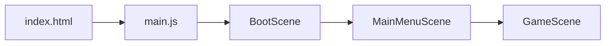

# Auditoria histórica do Abismo — seção A

> **Fonte:** [auditoria original de 2026-10-09](AUDITORIA_ORIGINAL_2026-10-09.md). Este é um **relato histórico**, não a situação atual comprovada. Afirmações de validação reproduzem o relatório antigo; não foram repetidas nesta edição.
> [Índice da auditoria](../auditoria_abismo.md) · [Índice da documentação](../README.md)

## A. Arquitetura Real

### Fluxo de inicialização

1. **[main.js](../../src/main.js)** — Cria `Phaser.Game` (1280×720, Arcade, sem gravidade). Registra 3 cenas.
2. **[BootScene.js](../../src/scenes/BootScene.js)** — Gera **todas as texturas programaticamente** (player, enemy, boss, tiles, partículas, sanctuary, chest, portal, xporb). Nenhum spritesheet externo é usado.
3. **[MainMenuScene.js](../../src/scenes/MainMenuScene.js)** — Menu com seed editável, "Novo Jogo" e "Continuar". Passa `seed`, `loadSave`, `slot` e `saveSystem` para GameScene.
4. **[GameScene.js](../../src/scenes/GameScene.js)** — Orquestra tudo: mundo, entidades, combate, loot, interações, UI, save e as recém implementadas lógicas de mecânicas ambientais.

### Geração do mundo

| Etapa | Arquivo | Função |
|-------|---------|--------|
| Seed determinística | [SeedSystem.js](../../src/world/SeedSystem.js) | `SeededRandom` (mulberry32) + `SeedSystem` (fork por área/sala) |
| Macroestrutura (grafo de salas) | [WorldGenerator.js](../../src/world/WorldGenerator.js) | `generateArea()` — espinha + ramificações + validação BFS |
| Microestrutura (tiles) | [RoomGenerator.js](../../src/world/RoomGenerator.js) | `generate()` — grid 40×22, *Atualizado para gerar perfis variados baseados nos 10 biomas* |
| Renderização | [GameScene.js](../../src/scenes/GameScene.js) | `_buildTilemap()` — itera grid, cria imagens e colliders |
| Spawn de conteúdo | [GameScene.js](../../src/scenes/GameScene.js) | Inimigos, boss, sanctuary, baú, e Hazards (perigos de ambiente) |
| Transição entre salas | [GameScene.js](../../src/scenes/GameScene.js) | Fade out → limpa sala → constrói nova → posiciona player → fade in |
| Avanço de área | [GameScene.js](../../src/scenes/GameScene.js) | `_advanceToNextArea()` — incrementa `abyssDepth` e `currentAreaIndex` |

### Dimensões confirmadas

- **Sala**: 40 × 22 tiles
- **Tile**: 32px
- **Sala em pixels**: 1280 × 704 (porém `ROOM_WIDTH=1280`, `ROOM_HEIGHT=720` em balance.js — desalinhamento sem impacto crítico)

### Sistemas de combate e Equipamento

- **Orquestração**: CombatSystem.js (✅ Funcional)
- **Fórmula de dano**: DamageSystem.js (✅ Funcional)
- **Parry**: ParrySystem.js (✅ Funcional)
- **Stamina**: StaminaSystem.js (✅ Funcional)
- **Equilíbrio/Stagger**: BalanceSystem.js (✅ Funcional)
- **Status Elemental**: StatusEffectSystem.js (✅ Funcional)
- **Armas e Armaduras**: WeaponSystem.js / ArmorSystem.js (✅ Funcional)
- **Inventário e Loot**: InventorySystem.js / LootSystem.js (✅ Funcional)
- **Progressão (Stat/Level/XP)**: StatSystem.js / XPSystem.js / LevelSystem.js (✅ Funcional)
- **Save**: SaveSystem.js (✅ Funcional)

---
