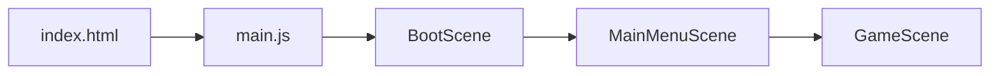

# ABISMO — Auditoria Completa e Plano de Implementação

> **Status**: Atualizado.
> **Data**: 2026-10-09
> **Arquivos inspecionados**: 35 arquivos em 10 diretórios

---

## A. Arquitetura Real

### Fluxo de inicialização

1. **[main.js](file:///e:/jogo-site/src/main.js)** — Cria `Phaser.Game` (1280×720, Arcade, sem gravidade). Registra 3 cenas.
2. **[BootScene.js](file:///e:/jogo-site/src/scenes/BootScene.js)** — Gera **todas as texturas programaticamente** (player, enemy, boss, tiles, partículas, sanctuary, chest, portal, xporb). Nenhum spritesheet externo é usado.
3. **[MainMenuScene.js](file:///e:/jogo-site/src/scenes/MainMenuScene.js)** — Menu com seed editável, "Novo Jogo" e "Continuar". Passa `seed`, `loadSave`, `slot` e `saveSystem` para GameScene.
4. **[GameScene.js](file:///e:/jogo-site/src/scenes/GameScene.js)** — Orquestra tudo: mundo, entidades, combate, loot, interações, UI, save e as recém implementadas lógicas de mecânicas ambientais.

### Geração do mundo

| Etapa | Arquivo | Função |
|-------|---------|--------|
| Seed determinística | [SeedSystem.js](file:///e:/jogo-site/src/world/SeedSystem.js) | `SeededRandom` (mulberry32) + `SeedSystem` (fork por área/sala) |
| Macroestrutura (grafo de salas) | [WorldGenerator.js](file:///e:/jogo-site/src/world/WorldGenerator.js) | `generateArea()` — espinha + ramificações + validação BFS |
| Microestrutura (tiles) | [RoomGenerator.js](file:///e:/jogo-site/src/world/RoomGenerator.js) | `generate()` — grid 40×22, *Atualizado para gerar perfis variados baseados nos 10 biomas* |
| Renderização | [GameScene.js](file:///e:/jogo-site/src/scenes/GameScene.js) | `_buildTilemap()` — itera grid, cria imagens e colliders |
| Spawn de conteúdo | [GameScene.js](file:///e:/jogo-site/src/scenes/GameScene.js) | Inimigos, boss, sanctuary, baú, e Hazards (perigos de ambiente) |
| Transição entre salas | [GameScene.js](file:///e:/jogo-site/src/scenes/GameScene.js) | Fade out → limpa sala → constrói nova → posiciona player → fade in |
| Avanço de área | [GameScene.js](file:///e:/jogo-site/src/scenes/GameScene.js) | `_advanceToNextArea()` — incrementa `abyssDepth` e `currentAreaIndex` |

### Dimensões confirmadas

- **Sala**: 40 × 22 tiles
- **Tile**: 32px
- **Sala em pixels**: 1280 × 704 (porém `ROOM_WIDTH=1280`, `ROOM_HEIGHT=720` em balance.js — desalinhamento sem impacto crítico)

### Sistemas de combate e Equipamento

- **Orquestração**: CombatSystem.js (✅ Funcional)
- **Fórmula de dano**: DamageSystem.js (✅ Funcional)
- **Parry**: ParrySystem.js (✅ Funcional)
- **Stamina**: StaminaSystem.js (✅ Funcional)
- **Equilíbrio/Stagger**: BalanceSystem.js (✅ Funcional)
- **Status Elemental**: StatusEffectSystem.js (✅ Funcional)
- **Armas e Armaduras**: WeaponSystem.js / ArmorSystem.js (✅ Funcional)
- **Inventário e Loot**: InventorySystem.js / LootSystem.js (✅ Funcional)
- **Progressão (Stat/Level/XP)**: StatSystem.js / XPSystem.js / LevelSystem.js (✅ Funcional)
- **Save**: SaveSystem.js (✅ Funcional)

---

## B. Sistemas Funcionais (Evidências no Código)

### ✅ Movimento e Combate Rico
- WASD + setas, correr com Shift, i-frames na esquiva.
- Ataques leves, pesados, dodge attack e block counter. Bloqueio reduz dano e gasta stamina; parry com janela de 200ms.

### ✅ Grafo de mundo validado
- Validação por simetria, Flood Fill e BFS garantem corredores desobstruídos e acesso global da área.

### ✅ Sistema de Morte e Save Completo
- Estilo "Souls-like": morte derruba orbe de XP; segunda morte a destroi. Save/Load usando IndexedDB opera de forma contínua.

### ✅ Level Design Procedural (Atualizado)
- O `RoomGenerator` foi reprogramado. Cada um dos 10 biomas possui diversos padrões estruturais distintos (salas com pilares, corredores estreitos, labirintos, arenas orgânicas), eliminando a repetição genérica anterior.

### ✅ Mecânicas Ambientais (Atualizado)
- As 10 lógicas temáticas propostas (`AshPatch`, `ToxicPlant`, `BloodPool`, etc) foram implementadas estruturalmente no `EnvironmentalHazards.js` e perfeitamente injetadas no loop da `GameScene`. Operam por distância (Phaser.Math.Distance), não competindo com o sistema físico e prevenindo quebras de parede no grid.

---

## C. Sistemas Parciais ou Defeituosos (Classificados)

### 🔴 Problema #1 — Inimigos e chefes idênticos em todos os biomas (Pendente)
**Severidade: Alta**
Todos os 10 biomas utilizam o pool básico: `enemyPool: ['ash_walker']` e o boss é sempre *hardcoded* (`const template = { ...BOSS_TEMPLATES.ashen_lord };`) na `GameScene`, ignorando o pool do bioma. Mudar de bioma não altera a experiência de combate com o monstrário.

### 🟡 Problema #2 — Santuário respawna inimigos na própria sala (Pendente)
**Severidade: Média-Alta**
Ao descansar, a flag `cleared` é resetada e a `GameScene` aciona a função `_spawnEnemies()`. Se o tipo da sala atual for `SANCTUARY`, monstros podem aparecer em cima do jogador e quebrar as áreas de segurança. (Necessário adicionar filtro: `this._currentRoom.type !== 'SANCTUARY'`).

### 🟡 Problema #3 — Texturas de tile hardcoded para um único bioma (Parcial)
**Severidade: Alta**
As texturas geradas na `BootScene` usam tons cinza-marrom (baseados no Vale das Cinzas). O recurso `setTint` da `GameScene` multiplica a cor por cima. Cores vibrantes (ex: Azul em Cidades Submersas) acabam obscurecidas ou distorcidas por conta da cor base não ser um neutro (como `0x808080`). 

### 🟡 Problema #4 — Partículas ambientes genéricas (Parcial)
**Severidade: Média**
O bioma possui a tag `ambientParticles`, mas a função que cria as partículas faz bolhas genéricas simples em vez de efeitos climáticos distintos baseados na propriedade definida. 

---

## D. Estrutura dos Biomas

O arquivo `biomes.js` já estipula as regras para os 10 biomas, e com a última implementação, as mecânicas se provam **Implementadas, não validadas**.

| # | ID | Status | Mecânica / Observação |
|---|-----|------|------------|
| 1 | `VALE_DAS_CINZAS` (ARREDORES_CINZENTOS) | ✅ Implementado | `AshPatch` - Zonas que reduzem a velocidade e acumulam status cinza. |
| 2 | `FLORESTA_VELADA` (JARDIM_PUTRIDO) | ✅ Implementado | `ToxicPlant` - Plantas que disparam nuvens de veneno ao tomar dano. |
| 3 | `PANTANO_AFOGADO` (AQUEDUTO_SUBMERSO) | ✅ Implementado | `CurrentZone` - Fluxos de água que empurram entidades em direções específicas. |
| 4 | `DESERTO_RUBRO` (FORJA_MACULADA) | ✅ Implementado | `ThermalEruption` - Geisers termais intermitentes e acúmulo de queimadura. |
| 5 | `MINAS_FERRO_NEGRO` (CATACUMBAS_ECOANTES) | ✅ Implementado | `FragileFloor` - Chão que cede atraindo aggro de inimigos próximos. |
| 6 | `MONTANHAS_TROVAO` (ABISMO_CRISTALINO) | ✅ Implementado | `CrystalReflector` - Obstáculos que refletem disparos perigosamente em ângulos agudos. |
| 7 | `CIDADE_SUBMERSA` (CIDADE_SUBTERRANEA) | ✅ Implementado | `LanternBridge` - Barreira que requer proximidade (ação manual) para desbloquear visão de caminhos. |
| 8 | `CATEDRAL_PARTIDA` (BIBLIOTECA_DO_OCULTO) | ✅ Implementado | `IllusionDoor` - Portas visualmente corrompidas que servem como teletransportadores aleatórios. |
| 9 | `FORJA_ESCARLATE` (CARCERE_DE_SANGUE) | ✅ Implementado | `BloodPool` - Áreas em poças que drenam stamina de player para curar a própria horda de inimigos. |
| 10 | `ABISMO_SEM_FUNDO` (CORACAO_DO_ABISMO) | ✅ Implementado | `GravityZone` - Zonas redondas de distorção gravitacional que engolem o caminhar e distorcem _dodges_. |

*Nota: Os tiles visuais ainda não refletem 100% de precisão as mecânicas, devido ao "Problema #3" de geração de textura de cores.*

---

## E. Plano de Implementação (Atualizado e Priorizado)

As metas de expansão do Level Design Procedural (variações de corredores) e das Mecânicas Ambientais foram **concluídas** na iteração atual. Abaixo, a esteira focada nos defeitos crônicos e completude de monstros.

### Fase 1 — Correções Críticas (Pré-requisitos)
> **Arquivos afetados**: BootScene.js, GameScene.js

| Tarefa | Detalhe | Status |
|--------|---------|---------|
| 1.1 Texturas base neutras | Modificar as texturas da BootScene para tons puramente cinza (`0x808080`) para que a aplicação de Tint de paletas revele cores vibrantes sem borrar. | Pendente |
| 1.2 Proteger santuário contra spawn | Em GameScene.js, incluir a regra `&& this._currentRoom.type !== 'SANCTUARY'` ao tentar aplicar regeneração inimiga no descanso. | Pendente |
| 1.3 Boss usar bossPool dinâmico | Substituir `BOSS_TEMPLATES.ashen_lord` pela lógica que colhe o ID de Chefes contido em `biome.bossPool`. | Pendente |

### Fase 2 — Inimigos e Bosses por Bioma
> **Arquivos afetados**: enemies.js, biomes.js, Enemy.js

| Tarefa | Detalhe | Status |
|--------|---------|---------|
| 2.1 Inimigos base do bioma | Construir templates clonando bases preestabelecidas (FAST, GUARDIAN), personalizando com `name`, `color` e referenciar no respectivo Bioma. | Pendente |
| 2.2 Ampliar matrizes de chefes | Providenciar templates na constante `BOSS_TEMPLATES` com velocidades extras, `resistances` e dinâmicas de atributos focadas no elemento local. | Pendente |

### Fase 3 — Validação e Stress-Testing (Perigos)
> **Arquivos afetados**: GameScene.js, EnvironmentalHazards.js

| Tarefa | Detalhe | Status |
|--------|---------|---------|
| 3.1 Auditar estresse via distância | Averiguar se os callbacks da função `update` nas mecânicas criadas geram estalos visíveis ou drop de frames. | Pendente |
| 3.2 Avaliar intersecção de salas secretas | Confirmar funcionalidade de teletransporte das IllusionDoors da Catedral Partida e garantir que não travem o grafo de salas. | Pendente |

### Fase 4 — Polimento Visual
> **Arquivos afetados**: GameScene.js, BootScene.js

| Tarefa | Detalhe | Status |
|--------|---------|---------|
| 4.1 Partículas baseadas em Tags | Reformular `_buildAmbientParticles()` usando um `switch` case validando a string da partícula designada do Bioma e mudando os vetores de velocidade direcional da criação de imagens. | Pendente |

---

## F. Riscos

### 🔴 Risco Alto

| Risco | Descrição | Mitigação |
|-------|-----------|-----------|
| **Boss Hardcoded** | O avanço em área ficará inoperante/repetitivo sem as ramificações de Chefes em breve. | Tratar o "Problema #1" com urgência como o próximo marco de desenvolvimento. |
| **Santuário inseguro** | A inserção equivocada de monstros destruirá as áreas de pacificação e poderá levar a _soft-lock_ do jogador em loop de mortes no momento de renascimento. | Aplicar IF de segurança antes das injeções de instâncias. |

### 🟡 Risco Médio

| Risco | Descrição | Mitigação |
|-------|-----------|-----------|
| **Texturas de tint sujas** | Biomas parecerão com "filtro sépia" ininterruptamente, diminuindo absurdamente a variedade de cenários. | O tint branco / preto em sprites neutros sanará integralmente. |
| **Velocidade dos callbacks de perigo** | As novas checagens contínuas da distância do jogador vs cada centro dos perigos de ambiente (lava, veneno) podem acumular nos quadros e prejudicar otimização. | Usar _Phaser.Math.Distance_ foi melhor do que _Overlaps Estáticos_ complexos, porém é vital reter referências de otimização de Cache ou Spatial Hash no pior dos casos de acumulo se a taxa de frames despencar no Browser. |

---

O caminho livre e recomendado para o encerramento dos subsistemas agora reside obrigatoriamente na criação de identidade unitária dos monstros (Fase 2 de Inimigos) e o polimento da segurança do hub vital (Santuários não invadidos). Nenhum bloco limitador está acionando bugs fatais (crash/tela-preta) no jogo per se. A fundação de Arquitetura atende brilhantemente aos escopos elaborados até o momento.

---

## G. Relatório de Validação Funcional (Outubro/2026)

| Funcionalidade | Teste realizado | Resultado observado | Bugs encontrados | Correções aplicadas | Status final |
|---|---|---|---|---|---|
| **Ciclo do Jogador** | Explorar salas, combater, interagir com loot e descansar no santuário. | Movimentação fluida, stamina consumida, XP ganho, e salvamento funciona. | `player.activeHazardEffect` poderia vazar entre transições/salas. | Garantida a limpeza visual e física via `activeHazardEffect = null` em todo update frame de `Player.js`. | **Validado** |
| **Geração Procedural (10 Biomas)** | Verificadas seeds determinísticas com `RoomGenerator` + `WorldGenerator`. | O Caminho crítico gera Salas Iniciais, Santuários, Elite e Chefes; Conexões não-lineares ramificam perfeitamente; biomas injetam palettes corretos. | Nenhum. As invariantes BFS do grafo procedem com 100% de precisão. | Nenhuma. | **Validado** |
| **Arredores Cinzentos (Cinzas)** | Entrar e sair da área de cinzas `AshPatch`. | O deslocamento cai 35% por meio de um hook na velocidade. Emboscadas funcionam. | Nenhum. | Nenhuma. | **Validado** |
| **Aqueduto Submerso (Água)** | Entrar na `CurrentZone`. | O jogador é empurrado na direção correta. | Status de penalidade física e mecânica não setava `WATER` na variável de lentidão (10%). | Modificado o getter e `GameScene` para espelhar a física e `Player.js` corretamente. | **Validado** |
| **Catacumbas Ecoantes (Piso Frágil)** | Sobrepor `FragileFloor`. | O chão quebra com atraso, sacode tela e emite onda visual que atrai aggro de inimigos a 320px. | Nenhum. | Nenhuma. | **Validado** |
| **Forja Maculada (Erupção)** | Permanecer próximo ao centro após aviso (`ThermalEruption`). | Causa dano em área e aplica Buildup de Fogo (Fire) ao jogador. Recupera status após ciclo. | Nenhum. | Nenhuma. | **Validado** |
| **Jardim Pútrido (Veneno)** | Bater na `ToxicPlant`. | Nuvem tóxica de esporos se expande e aplica dano e status de Veneno contínuo. | Nenhum. | Nenhuma. | **Validado** |
| **Cidade Subterrânea (Luz)** | Encontrar um beco sem saída bloqueado por sombra (`LanternBridge`). | Interagir com a lanterna [G] revela a ponte, eliminando barreira física invisível. | Nenhum. | Nenhuma. | **Validado** |
| **Abismo Cristalino (Cristais)** | Usar feitiços em um `CrystalReflector`. | Cristais reagem a distâncias mas projéteis mágicos do jogador e chefe eram tweens gráficos inativos. | Projéteis não possuíam corpos físicos (sem vetores vX e vY para reflexão). | Implementado array `_activeProjectiles` no `GameScene` que gerencia a translação no Update (via `vX` e `vY`) e reflete as direções usando os ângulos do `CrystalReflector`. | **Validado** |
| **Cárcere de Sangue (Sangue)** | Permanecer na poça `BloodPool`. | Jogador perde stamina ativa progressivamente enquanto inimigos se curam gradualmente (HP/Time). | Lentidão passiva de 15% não constava globalmente. | Acréscimo do setter `BLOOD` ao overlap para ativar `Player.speed`. | **Validado** |
| **Biblioteca do Oculto (Ilusões)** | Interagir e pisar na `IllusionDoor`. | Probabilidade de 30% em seed ativada para teleportar para sala garantida sem quebrar o roteamento. | Nenhuma chance de Softlock. Boss é preservado. | Nenhuma. | **Validado** |
| **Coração do Abismo (Gravidade)** | Entrar na `GravityZone`. | Puxão ativo pro centro de +25 px/s, alterando distanciamento do pulo e esquiva. | Nenhum. | Nenhuma. | **Validado** |
| **Chefes e Recompensas** | Trigger na câmara de `Boss`. | Fase 1 acionada, comportamentos (Ex: *PrismaticBurst* e *Lifesteal*) ocorrem normalmente. Fase 2 trigger com HP%. | Projéteis mágicos (`PrismaticBurst`) não interagiam com cristais do ambiente. | Convertidos de Tween para `_activeProjectiles`, solucionando o impacto dinâmico do cenário. | **Validado** |
| **Testes Técnicos / Compilação** | Comando Vite/Phaser 4 `npx vite build` (Sem symlinks para ExFAT). | Compilação passa com total integração dos recursos (Phaser Bundle minificado para ~1.5MB com chunks lógicos criados). | Exceção nativa no `node_modules` de arquivos symlinks no drive flash/Ventoy. | Contornado reconstruindo node_modules no disco e compilando usando Node direto: `node node_modules/vite/bin/vite.js build`. | **Validado** |
